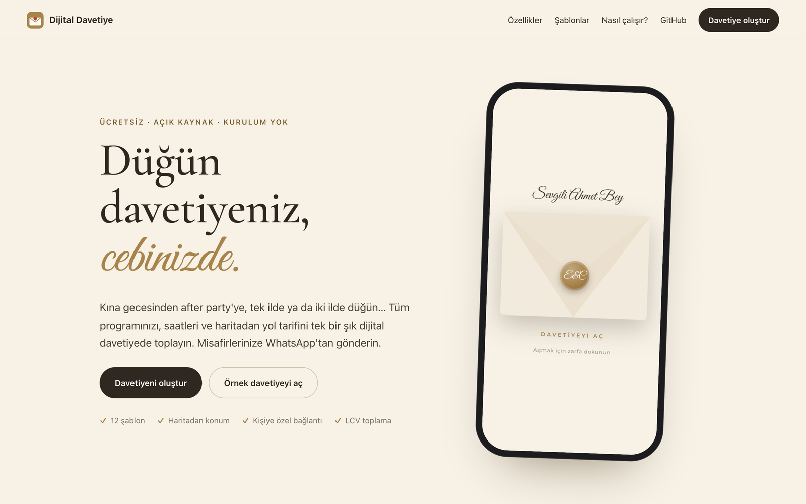
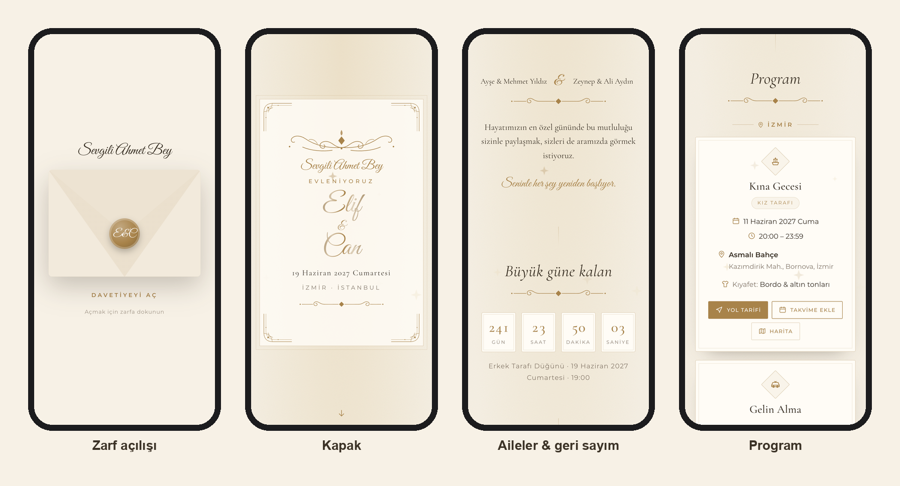
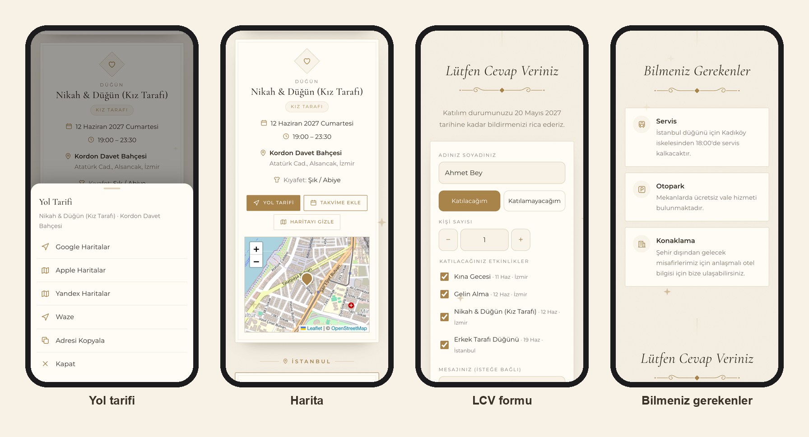
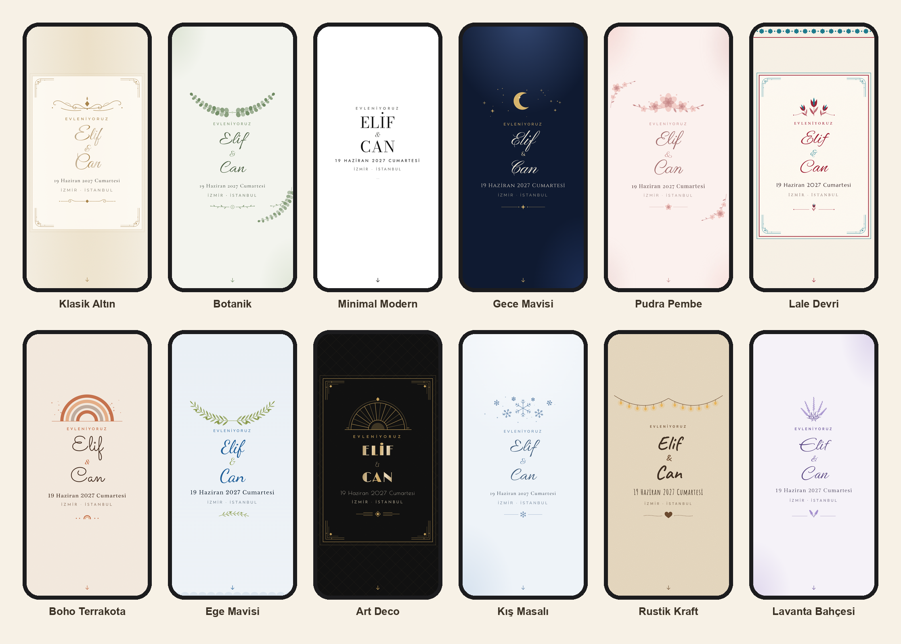
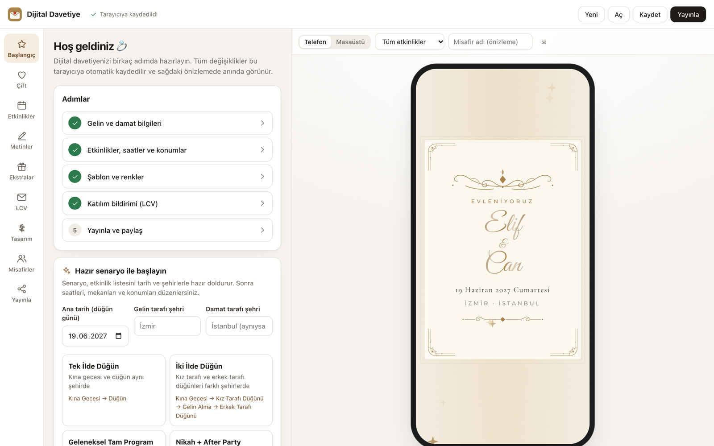
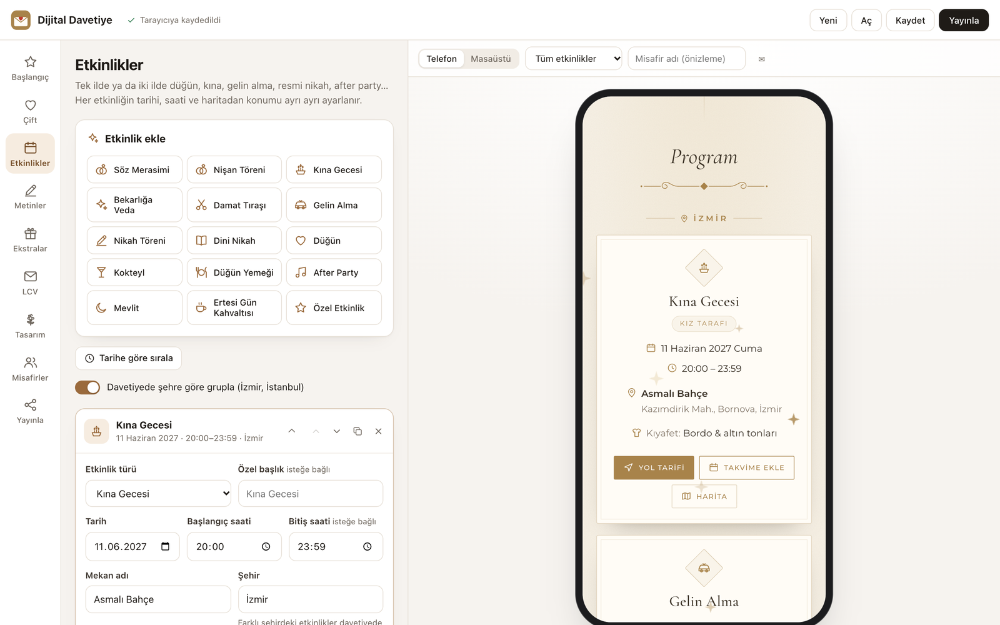
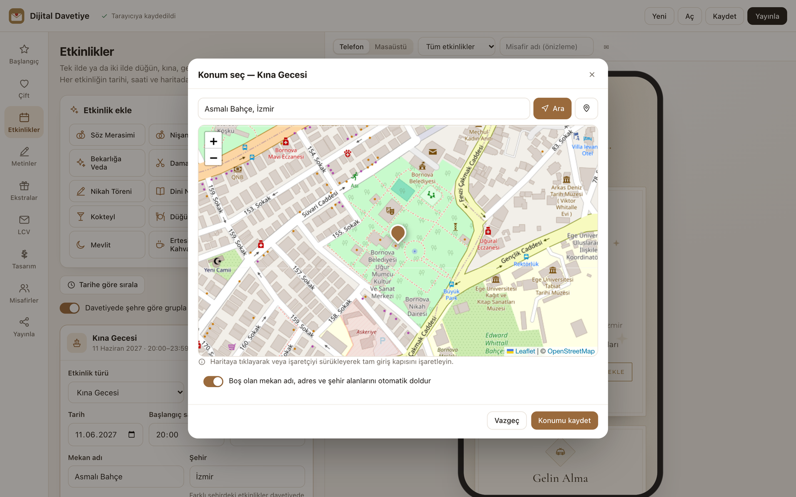
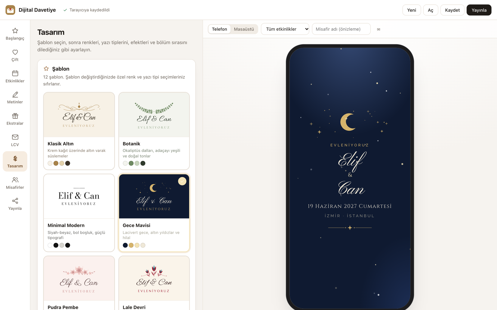
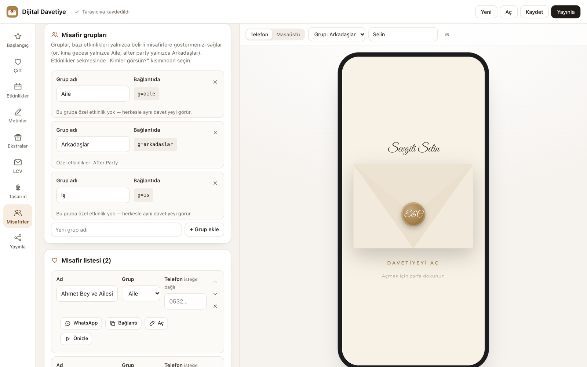
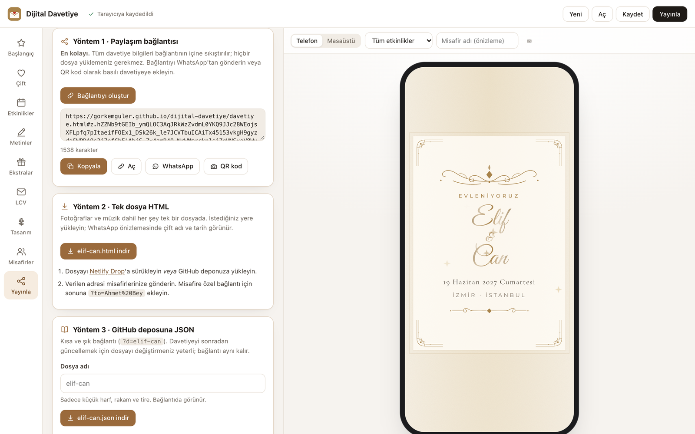

<div align="center">

# 💌 Dijital Davetiye

**Ücretsiz, açık kaynak ve kurulum gerektirmeyen dijital düğün davetiyesi oluşturucu**

[**✨ Hemen davetiyeni oluştur**](https://gorkemguler.github.io/dijital-davetiye/editor.html) &nbsp;·&nbsp;
[Örnek davetiye](https://gorkemguler.github.io/dijital-davetiye/davetiye.html?d=ornek&to=Ahmet%20Bey) &nbsp;·&nbsp;
[Tanıtım sayfası](https://gorkemguler.github.io/dijital-davetiye/)



</div>

Kına gecesinden after party'ye, tek ilde ya da iki ilde düğün… Tüm programınızı, saatleri ve haritadan yol tarifini tek bir şık dijital davetiyede toplayın; misafirlerinize adlarıyla seslenen özel bağlantıları WhatsApp'tan gönderin.

- 🎨 **12 şablon:** Klasik Altın, Botanik, Minimal Modern, Gece Mavisi, Pudra Pembe, Lale Devri, Boho Terrakota, Ege Mavisi, Art Deco, Kış Masalı, Rustik Kraft, Lavanta Bahçesi
- 🧩 **Derleme yok, sunucu yok:** Saf HTML/CSS/JS. İsterseniz hiçbir şey kurmadan kullanın, isterseniz kendi kopyanızı yayınlayın.
- 🇹🇷 **Türk düğün geleneklerine göre:** söz, nişan, kına, damat tıraşı, gelin alma, nikah, dini nikah, düğün, mevlit…
- 🔒 **Verileriniz sizde:** Üyelik yok, sunucu yok; bilgiler yalnızca sizin tarayıcınızda tutulur.

---

## 🚀 Hemen kullanın — hiçbir şey kurmadan

1. **[Editörü açın](https://gorkemguler.github.io/dijital-davetiye/editor.html)** — örnek bir davetiyeyle başlar.
2. **Başlangıç** sekmesinden hazır bir senaryo seçin (*Tek ilde düğün*, *İki ilde düğün*, *Nikah + After Party*…), tarihi ve şehirleri yazın.
3. **Çift**, **Etkinlikler** (haritadan konum seçin), **Metinler**, **Tasarım** sekmelerinde davetiyenizi kişiselleştirin — sağdaki önizleme anında güncellenir.
4. **Yayınla → Bağlantıyı oluştur** ile davetiye bağlantınızı alın, WhatsApp'tan gönderin ya da QR kodunu basılı davetiyeye ekleyin.
5. Misafirlerinize adlarıyla seslenmek için **Misafirler** sekmesinden kişiye özel bağlantılar oluşturun.

> Editördeki her şey tarayıcınıza otomatik kaydedilir. Başka bir cihazda devam etmek için **Kaydet** ile proje dosyasını indirip **Aç** ile yükleyin.

---

## 📸 Ekran görüntüleri

### Misafirin gördüğü davetiye





### 12 şablon

Her şablonun renkleri, yazı tipleri, kapak düzeni ve efekti editörden değiştirilebilir.



### Editör

| | |
|---|---|
|  |  |
| **Başlangıç** — adımlar ve hazır senaryolar | **Etkinlikler** — her etkinliğin tarihi, saati, mekanı |
|  |  |
| **Haritadan konum** — arayın veya işaretleyin | **Tasarım** — şablon, renk, yazı tipi, efekt |
|  |  |
| **Misafirler** — gruplar ve kişiye özel davet | **Yayınla** — bağlantı, tek dosya HTML, JSON, QR |

---

## İçindekiler

- [Hemen kullanın](#-hemen-kullanın--hiçbir-şey-kurmadan)
- [Ekran görüntüleri](#-ekran-görüntüleri)
- [Özellikler](#-özellikler)
- [Kendi kopyanızı yayınlayın](#-kendi-kopyanızı-yayınlayın)
- [Paylaşım yöntemleri](#-paylaşım-yöntemleri)
- [Kişiye özel bağlantılar ve misafir grupları](#-kişiye-özel-bağlantılar-ve-misafir-grupları)
- [LCV (katılım) yanıtlarını toplama](#-lcv-katılım-yanıtlarını-toplama)
- [Site ayarları](#️-site-ayarları-siteconfigjs)
- [Yerelde çalıştırma](#-yerelde-çalıştırma)
- [Proje yapısı](#-proje-yapısı)
- [Gizlilik](#-gizlilik)
- [Katkıda bulunma](#-katkıda-bulunma)
- [English](#english)

---

## ✨ Özellikler

| | |
|---|---|
| **Sınırsız etkinlik** | 15 etkinlik türü (söz, nişan, kına gecesi, bekarlığa veda, damat tıraşı, gelin alma, nikah töreni, dini nikah, düğün, kokteyl, düğün yemeği, after party, mevlit, ertesi gün kahvaltısı, özel). Her birinin kendi tarihi, saati, mekanı ve konumu vardır. |
| **Tek il / iki il** | Farklı şehirlerdeki etkinlikler davetiyede otomatik olarak şehre göre gruplanır. Kız tarafı / erkek tarafı rozetleri. |
| **Hazır senaryolar** | Tek ilde düğün, iki ilde düğün, geleneksel tam program, nikah + after party, kır düğünü, nişan, söz, kına… Tek tıkla etkinlik listesi hazır. |
| **Haritadan konum** | Mekanı arayın ya da haritada işaretleyin (OpenStreetMap). Google Maps / Yandex / Apple Maps linki yapıştırarak da konum alabilirsiniz. |
| **Yol tarifi** | Misafirler tek dokunuşla Google Haritalar, Apple Haritalar, Yandex Haritalar veya Waze ile yol tarifi alır; adresi kopyalar; davetiye içinde haritayı görür. |
| **Takvime ekle** | Google Takvim ve Apple/Outlook (.ics) — tek etkinlik ya da tüm program. Saat dilimi destekli (yurt dışı düğünler için). |
| **Geri sayım** | Ana etkinliğe kalan gün/saat/dakika/saniye. |
| **Zarf animasyonu** | Davetiye, üzerinde çiftin baş harfleri olan mühürlü bir zarfın açılmasıyla başlar. |
| **Kişiye özel bağlantı** | `?to=Ahmet Bey` → zarfta ve kapakta "Sevgili Ahmet Bey". Toplu misafir ekleme, WhatsApp ile tek tek gönderme, CSV/Excel dışa aktarma. |
| **Misafir grupları** | Bazı etkinlikleri sadece belirli gruplara gösterin (ör. after party yalnızca Arkadaşlar). |
| **LCV** | WhatsApp, e-posta, Google E-Tablolar, Formspree veya harici form. Kişi sayısı ve katılacağı etkinlikler sorulabilir. |
| **İçerik** | Kapak fotoğrafı, galeri, tanışma hikayesi, aile adları, alıntı/şiir, bilgi kartları (servis, otopark, konaklama…), IBAN/hediye, iletişim kişileri, arka plan müziği, hashtag. |
| **Tasarım** | Şablon, renkler (hazır paletler dahil), 47 Türkçe destekli yazı tipi, 5 kapak düzeni, 2 etkinlik görünümü, 8 hareketli efekt, fotoğraf filtreleri, bölüm sıralama/gizleme. |
| **Dil** | Davetiye Türkçe veya İngilizce. |
| **Yayınlama** | Paylaşım bağlantısı, tek dosya HTML veya GitHub deposunda JSON. QR kod üretimi. |

---

## 🏠 Kendi kopyanızı yayınlayın

Davetiyenizi kendi GitHub hesabınızda barındırmak, kısa bağlantı (`?d=elif-can`) kullanmak veya projeyi değiştirmek isterseniz 5 dakikada kendi kopyanızı yayına alabilirsiniz.

### 1. Kopyanızı oluşturun

Bu sayfanın üstündeki yeşil **Use this template → Create a new repository** düğmesine basın (veya **Fork**'layın). Depo adını `dijital-davetiye` olarak bırakabilirsiniz.

### 2. GitHub Pages'i açın

Yeni deponuzda: **Settings → Pages → Build and deployment**

- **Source:** `Deploy from a branch`
- **Branch:** `main` · klasör: `/ (root)` → **Save**

1–2 dakika sonra siteniz şu adreste yayında olur:

```
https://KULLANICI-ADINIZ.github.io/dijital-davetiye/
```

### 3. (İsteğe bağlı) `site.config.js` dosyasını düzenleyin

```js
window.DV_SITE = {
  home: 'landing',                 // 'landing' | 'invite' | 'editor'
  defaultInvitation: 'ornek',      // invitations/ornek.json
  baseUrl: 'https://KULLANICI-ADINIZ.github.io/dijital-davetiye/',
  repoUrl: 'https://github.com/KULLANICI-ADINIZ/dijital-davetiye'
};
```

### 4. Davetiyenizi oluşturun

`https://KULLANICI-ADINIZ.github.io/dijital-davetiye/editor.html` adresini açın:

1. **Başlangıç:** Hazır bir senaryo seçin (ör. *İki İlde Düğün*), ana tarihi ve şehirleri yazın.
2. **Çift:** İsimler, aile adları, kapak fotoğrafı.
3. **Etkinlikler:** Her etkinliğin saatini, mekanını girin, **Haritadan seç** ile konumu işaretleyin.
4. **Metinler / Ekstralar / LCV / Tasarım:** Dilediğiniz gibi kişiselleştirin. Sağdaki önizleme anında güncellenir.
5. **Yayınla:** Bağlantınızı oluşturun ve paylaşın.

Editördeki tüm değişiklikler tarayıcınıza otomatik kaydedilir. Başka bir bilgisayarda devam etmek için **Kaydet** ile proje dosyasını indirip **Aç** ile yükleyin.

---

## 🔗 Paylaşım yöntemleri

| Yöntem | Nasıl? | Artıları | Dikkat |
|---|---|---|---|
| **1. Paylaşım bağlantısı** | Editör → Yayınla → *Bağlantıyı oluştur* | En kolayı. Hiçbir dosya yüklemezsiniz; tüm bilgiler bağlantının `#` kısmına sıkıştırılır. | Bağlantı uzundur (~1,5 KB). Cihazdan yüklenen fotoğraf/müzik bağlantıya sığmaz — görsel bağlantısı (URL) kullanın. |
| **2. Tek dosya HTML** | Editör → Yayınla → *HTML indir* | Fotoğraflar ve müzik dahil her şey tek dosyada. Netlify Drop, GitHub Pages veya kendi hostinginize yükleyin. WhatsApp önizlemesinde çift adı ve tarih görünür. | Dosyayı bir yere yüklemeniz gerekir. |
| **3. GitHub deposunda JSON** | Editör → Yayınla → *JSON indir* → depodaki `invitations/` klasörüne yükleyin | Kısa ve şık bağlantı: `.../davetiye.html?d=elif-can`. Dosyayı güncelleyince davetiye de güncellenir, bağlantı aynı kalır. | Herkese açık depolarda JSON dosyası da herkese açıktır. |

> **İpucu:** Davetiyenizi doğrudan ana sayfada göstermek için `site.config.js` içinde `home: 'invite'` ve `defaultInvitation: 'elif-can'` yapın.

---

## 👥 Kişiye özel bağlantılar ve misafir grupları

Davetiye sayfası şu adres parametrelerini anlar:

| Parametre | Örnek | Anlamı |
|---|---|---|
| `to` | `?to=Ahmet%20Bey` | Zarfta ve kapakta "Sevgili Ahmet Bey" yazar, LCV formunda ad hazır gelir. |
| `g` | `?g=arkadaslar` | Misafir grubu. Yalnızca bu gruba özel işaretlenmiş etkinlikler (ve herkese açık olanlar) görünür. |
| `d` | `?d=elif-can` | `invitations/elif-can.json` dosyasını yükler. |
| `t` | `?t=gece-mavisi` | Şablonu geçici olarak değiştirir (önizleme için). |

Editördeki **Misafirler** sekmesinde misafir listesini girip (toplu ekleme destekli) her misafire tek tıkla WhatsApp'tan kişiye özel davet gönderebilir veya tüm bağlantıları CSV/Excel olarak indirebilirsiniz.

> Gruplar bir **güvenlik** önlemi değil, **kişiselleştirme** özelliğidir: bağlantıdaki `g=` değerini değiştiren biri diğer etkinlikleri de görebilir.

---

## 📝 LCV (katılım) yanıtlarını toplama

Editör → **LCV** sekmesinden yöntemi seçin:

| Yöntem | Kurulum | Sonuç |
|---|---|---|
| **WhatsApp** | Numaranızı yazın | Misafir formu doldurunca hazır mesajla WhatsApp açılır. |
| **Google E-Tablolar** | 5 dakikalık kurulum → [docs/lcv-google-sheets.md](docs/lcv-google-sheets.md) | Her yanıt otomatik olarak tablonuza satır olarak eklenir. |
| **Formspree** | [formspree.io](https://formspree.io)'da ücretsiz form açın | Her yanıt e-postanıza gelir. |
| **E-posta** | Adresinizi yazın | Misafirin e-posta uygulaması hazır mesajla açılır. |
| **Harici form** | Google Forms vb. bağlantısı | Davetiyede "Katılım formunu aç" düğmesi görünür. |

---

## ⚙️ Site ayarları (`site.config.js`)

| Ayar | Varsayılan | Açıklama |
|---|---|---|
| `home` | `'landing'` | Ana sayfa (`index.html`) ne göstersin: tanıtım sayfası, doğrudan davetiye ya da editör. |
| `defaultInvitation` | `'ornek'` | `?d=` verilmediğinde yüklenecek `invitations/*.json` dosyası. |
| `baseUrl` | `''` | Paylaşım bağlantılarında kullanılacak site adresi. Boşsa editörün açıldığı adres kullanılır. |
| `repoUrl` | `''` | Davetiye altındaki "Dijital Davetiye ile hazırlandı" bağlantısı ve tanıtım sayfasındaki GitHub linki. |

---

## 💻 Yerelde çalıştırma

Derleme adımı yoktur; dosyaları herhangi bir statik sunucuyla açmanız yeterli:

```bash
python3 -m http.server 8000
```

veya

```bash
npx serve .
```

Ardından `http://localhost:8000/editor.html` adresini açın.

> Dosyaları çift tıklayarak (`file://`) da açabilirsiniz; editör ve önizleme çalışır. Ancak *tek dosya HTML* dışa aktarımı ve `?d=` ile JSON yükleme için bir sunucu gerekir. Ayrıca yerelde oluşturulan bağlantılar başkalarının cihazında açılmaz — paylaşmadan önce GitHub Pages'te yayınlayın.

---

## 🗂 Proje yapısı

```
├── index.html              Tanıtım sayfası (site.config.js'e göre yönlendirir)
├── editor.html             Davetiye editörü
├── davetiye.html           Davetiye sayfası (misafirlerin gördüğü)
├── site.config.js          Site ayarları
├── assets/
│   ├── css/
│   │   ├── invite.css      Davetiye temel stilleri
│   │   ├── editor.css      Editör arayüzü
│   │   └── landing.css     Tanıtım sayfası
│   ├── js/
│   │   ├── core.js         Ortak: veri modeli, tarih/saat, harita/takvim linkleri, çeviriler, kodlama
│   │   ├── templates.js    Şablon kaydı + SVG süsleme üreticileri
│   │   ├── invite.js       Davetiye sayfası (çizim, zarf, geri sayım, harita, LCV, efektler)
│   │   └── editor/         app.js · tabs.js · map.js · publish.js
│   └── img/
├── templates/              Her şablonun kendi CSS dosyası
├── invitations/            JSON davetiyeler (ornek.json) ve görselleri (img/)
└── docs/                   Rehberler
```

Kullanılan dış kaynaklar: [Leaflet](https://leafletjs.com) (harita, cdnjs), [qrcode-generator](https://github.com/kazuhikoarase/qrcode-generator) (QR, cdnjs), [OpenStreetMap](https://www.openstreetmap.org) (harita karoları), [Nominatim](https://nominatim.org) (editörde adres arama), Google Fonts (yazı tipleri). API anahtarı gerekmez.

---

## 🔒 Gizlilik

- **Editör** verileri yalnızca sizin tarayıcınızda (IndexedDB) tutulur; hiçbir sunucuya gönderilmez.
- **Misafir listesi** davetiyeye asla eklenmez; sadece editörde ve proje dosyanızda kalır.
- **Paylaşım bağlantısında** veriler adresin `#` kısmındadır; bu kısım tarayıcılar tarafından sunucuya gönderilmez.
- **Herkese açık bir GitHub deposuna** yüklediğiniz JSON/HTML dosyaları (adres, telefon numarası vb.) herkes tarafından görülebilir. İsterseniz *Yöntem 1*'i kullanın ya da hassas bilgileri (telefon, IBAN) eklemeyin.
- Davetiye sayfası arama motorlarına `noindex` ile kapalıdır.
- OpenStreetMap karo sunucuları düşük trafikli kullanım içindir. Çok yoğun trafik bekliyorsanız `assets/js/core.js` içindeki `DV.tileLayer`'a kendi karo sağlayıcınızı yazın.

---

## 🤝 Katkıda bulunma

Katkılarınızı bekliyoruz — özellikle **yeni şablonlar**! Başlamadan önce [CONTRIBUTING.md](CONTRIBUTING.md) ve [docs/sablon-ekleme.md](docs/sablon-ekleme.md) dosyalarına göz atın.

Fikir ve hata bildirimleri için *Issues* bölümünü kullanabilirsiniz.

## 📄 Lisans

[MIT](LICENSE) — dilediğiniz gibi kullanın, değiştirin, paylaşın.

---

## English

**[▶ Try it now](https://gorkemguler.github.io/dijital-davetiye/editor.html)** · **[Demo invitation](https://gorkemguler.github.io/dijital-davetiye/davetiye.html?d=ornek)**

**Dijital Davetiye** is a free, open-source, zero-build **digital wedding invitation builder** (Turkish-first, with full English invitation support).

- 12 templates, 15 event types (henna night, civil ceremony, after party…), multi-city weddings
- Map-based venue picker (OpenStreetMap), one-tap directions (Google / Apple / Yandex / Waze), add-to-calendar (.ics / Google)
- Envelope opening animation, countdown, gallery, story, info cards, gifts/IBAN, background music
- Personalized guest links (`?to=Name`), guest groups that see different events (`?g=group`)
- RSVP via WhatsApp, e-mail, Google Sheets, Formspree or any external form
- Publish as a self-contained share link (data in the URL fragment), a single HTML file, or a JSON file in your repo
- Pure HTML/CSS/JS — use the hosted editor, or click *Use this template*, enable GitHub Pages (`main` / root) and open `editor.html`

Run locally with `python3 -m http.server 8000` and open `http://localhost:8000/editor.html`. Licensed under MIT.
